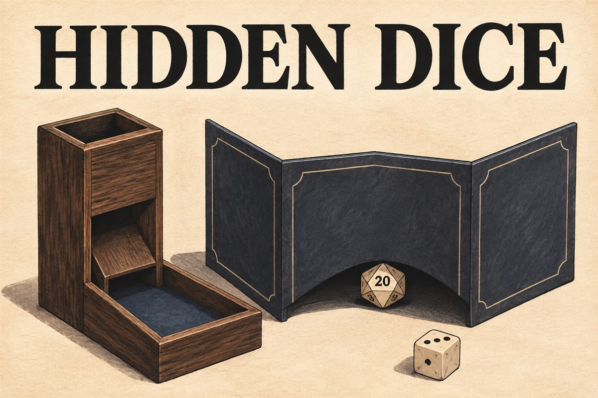
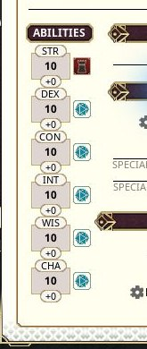

# Hidden Dice

[Fantasy Grounds forum thread](https://www.fantasygrounds.com/forums/showthread.php?88611) · [Fantasy Grounds Forge item 3792 — pending approval](https://forge.fantasygrounds.com/shop/items/3792/view) · [GitHub releases](https://github.com/alperozisik/FG-hidden-dice/releases)

> **Forge status:** The free Forge item and v0.1.3 build have been submitted, but the item is still pending approval/review and the build is queued for processing. The Forge page is not publicly available yet. Use the GitHub release for manual installation until approval and updater delivery are verified.

<p align="center">
  
</p>



Hidden Dice is a free Fantasy Grounds Unity extension for the D&D 5E ruleset. It lets the GM decide which supported character-sheet rolls default to hidden and which remain public, while players keep using the familiar sheet controls.

A hidden Stealth check preserves uncertainty about how well a character is concealed. A hidden History or Arcana check lets the GM describe what the character recalls without the visible die result revealing how reliable that information may be.

The extension does not include replacement graphics. Normal-roll and dice-tower buttons use the resources supplied by the active ruleset or theme.


## Why use it?

- Choose the default hidden or visible state independently for each supported roll.
- Use **Set hidden for all** or **Set visible for all** to apply the matching roll across the party instead of visiting every sheet.
- Use **Toggle hidden roll** when one character needs an individual override.
- Keep rolling through the normal character-sheet button, related field, or newly created hotbar shortcut according to the configured handling mode.
- Retain per-character choices and GM-wide defaults when the campaign is reloaded.

Supported roll types:

- Ability checks
- Saving throws
- Skills
- Initiative
- Death saves

## How to use it

Right-click a supported d20 roll button to open its radial menu.

- **Toggle hidden roll** changes that roll for the current character only.
- **Set hidden for all** is GM-only. It hides the matching roll on every existing character and establishes hidden as the campaign default for that matching roll.
- **Set visible for all** is GM-only. It makes the matching roll visible on every existing character and establishes visible as the campaign default for that matching roll.

For example, the GM can right-click one character's Stealth button and choose **Set hidden for all**. Every character's Stealth roll then defaults to the dice tower, while Persuasion and other rolls keep their own settings. A later **Toggle hidden roll** can make Stealth visible for one character without changing the others.

The button displays the active theme's dice-tower icon when hidden rolling is enabled and its normal d20 icon when disabled. Hidden results go to the GM; the player receives normal dice-tower submission feedback. Visible rolls retain normal public handling.



## Settings

Open **Options → Game → Hidden Dice Handle**. This is a GM-controlled campaign option whose value is managed by CoreRPG's Options system. It determines which controls honor a roll's hidden/visible state; it does **not** choose which checks are hidden. v0.1.3 QA verified that the selection remained after closing and reopening the Options window; a full campaign reload of this option value was not repeated for that release.

Every available value:

- **Button & Modifier** (default) — The selected state applies to the supported roll button and its related modifier or total field. Field double-clicks, field drag rolls, and newly created hotbar shortcuts inherit that state.
- **Button only** — Automatic Hidden Dice handling is limited to the supported roll button. Related modifier or total fields do not inherit the state; use the configured button when its hidden/visible behavior is required.

Changing this option does not make any check hidden by itself. Use the roll button's radial menu to configure Stealth, History, Arcana, or another supported roll.


## Hotbar shortcuts

A shortcut records the hidden or visible state that was active when it was created. Recreate an existing shortcut after changing the roll state if the shortcut should use the new behavior.

This captured state is intentional: changing the source roll or **Hidden Dice Handle** does not rewrite an existing hotbar shortcut.

## Compatibility

- Fantasy Grounds Unity
- D&D 5E ruleset, release 9 or later
- Requested Rolls requests bypass Hidden Dice so that Requested Rolls retains control of player prompts, GM rolls, and result visibility in either handling mode. The latest direct Requested Rolls regression evidence is from Hidden Dice v0.1.1.

Focused v0.1.3 QA used Fantasy Grounds v5.1.15 and the 5E ruleset dated 2026-10-06 with the Default theme. It verified the option UI and persistence; earlier focused sessions verified button icons, GM-wide settings, campaign persistence, and two-client roll privacy. The full modifier/drag/double-click matrix, separate 2014/2024 content paths, and alternate themes were not repeated for v0.1.3.


## Build

Run the build script from PowerShell:

```powershell
./build.ps1
```

The packaged extension is written to `dist/HiddenDice.ext`.

The build stages the repository's `LICENSE` file as `LICENSE.txt` inside the extension and rejects packaged file types outside the Fantasy Grounds Forge whitelist. A successful build prints the package SHA-256 hash.

## Installation

### Fantasy Grounds Forge

After the item is approved, publicly listed, and its Live build is verified, add Hidden Dice to your Forge inventory and run **Check for Updates** from the Fantasy Grounds launcher. The submitted item is free (0 Gold), categorized as a **5E Compatible Extension**, and configured for the Fantasy Grounds **Data** install location.

### Manual installation

Copy either the project directory or `dist/HiddenDice.ext` into the `extensions` directory under the Fantasy Grounds data directory. When both are present, Fantasy Grounds loads the project directory before the packaged `.ext` file with the same internal extension name.

Enable **Hidden Dice** when loading a 5E campaign.

## Updating

- **Forge:** Once the item is live, run **Check for Updates** from the Fantasy Grounds launcher.
- **Manual:** Replace the existing `HiddenDice.ext` with the newer file, then restart Fantasy Grounds.

If a manually installed project directory and a packaged `.ext` file are both present, remove the project directory unless it is intentionally being used for development.

## Removing

Disable **Hidden Dice** for the campaign, then use the matching method:

- **Forge:** Once the item is live, disable it in the Forge inventory and run **Check for Updates**. If a manually installed copy also exists, remove it from the Fantasy Grounds `extensions` directory.
- **Manual:** Delete `HiddenDice.ext` or the unpacked Hidden Dice project directory from the Fantasy Grounds `extensions` directory.

Restart Fantasy Grounds after removing the extension.

## Support

Discuss the extension in the [Fantasy Grounds forum thread](https://www.fantasygrounds.com/forums/showthread.php?88611) or report reproducible bugs through the [GitHub issue tracker](https://github.com/alperozisik/FG-hidden-dice/issues). Include the Fantasy Grounds version, 5E ruleset version, enabled extensions, the roll type used, and any console error text.
