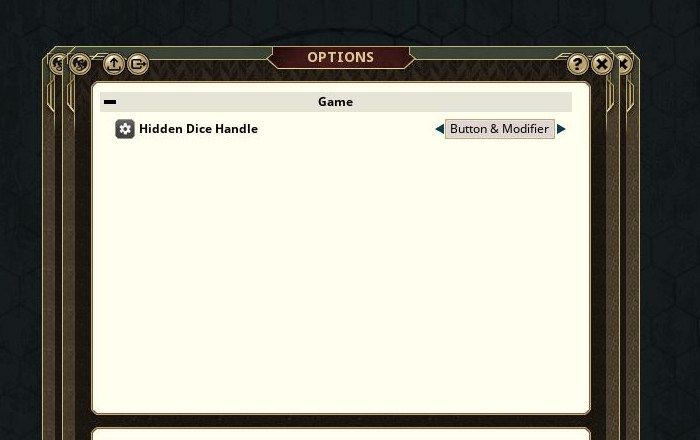
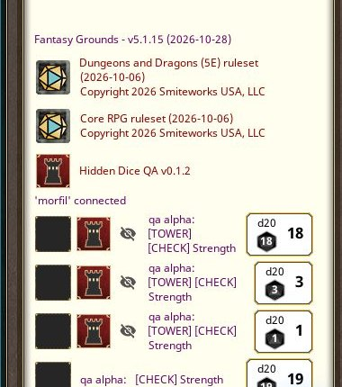

# Hidden Dice

Hidden Dice is a Fantasy Grounds Unity extension for the D&D 5E ruleset. It lets players choose which character-sheet rolls use the dice tower by default while preserving the active Fantasy Grounds theme.

The extension does not include replacement graphics. Normal-roll and dice-tower buttons use the resources supplied by the active ruleset or theme.





## Features

- Toggle hidden rolling independently for supported rolls on each character sheet.
- Reuse the selected hidden or visible state when rolling from related modifier fields.
- Preserve the selected state when creating a hotbar shortcut.
- Let the GM set the matching roll to hidden or visible for every character at once.
- Store settings per character and roll.

Supported roll types:

- Ability checks
- Saving throws
- Skills
- Initiative
- Death saves

## Usage

Right-click a supported d20 roll button to open its radial menu.

- **Toggle hidden roll** changes the state of that roll for the current character.
- **Set hidden for all** is available to the GM and hides the matching roll on every character sheet.
- **Set visible for all** is available to the GM and makes the matching roll visible on every character sheet.

The button displays the active theme's dice-tower icon when hidden rolling is enabled and its normal d20 icon when disabled.

## Campaign option

The **Hidden Dice Handle** option is available in the Fantasy Grounds campaign settings:

- **Button & Modifier** (default) applies the selected state to the roll button and its related modifier or total field. Dragging a roll, creating a hotbar shortcut, or double-clicking the field uses the selected hidden or visible state.
- **Button only** limits automatic hidden-roll handling to the roll button.

## Hotbar shortcuts

A shortcut records the hidden or visible state that was active when it was created. Recreate an existing shortcut after changing the roll state if the shortcut should use the new behavior.

For hidden player rolls, the player receives the normal dice-tower submission feedback while the GM receives the result.

## Compatibility

- Fantasy Grounds Unity
- D&D 5E ruleset, release 9 or later
- Requested Rolls requests bypass Hidden Dice so that Requested Rolls retains control of player prompts, GM rolls, and result visibility.

v0.1.2 was packaging-only. v0.1.3 restores the **Hidden Dice Handle** entry in the current CoreRPG Options window by registering its label and cycler type explicitly during extension initialization.

## Build

Run the build script from PowerShell:

```powershell
./build.ps1
```

The packaged extension is written to `dist/HiddenDice.ext`.

The build stages the repository's `LICENSE` file as `LICENSE.txt` inside the extension and rejects packaged file types outside the Fantasy Grounds Forge whitelist. A successful build prints the package SHA-256 hash.

## Installation

### Fantasy Grounds Forge

Add Hidden Dice to your Forge inventory, make sure it is enabled there, and run **Check for Updates** from the Fantasy Grounds launcher. Forge items are delivered and updated through the Fantasy Grounds updater.

### Manual installation

Copy either the project directory or `dist/HiddenDice.ext` into the `extensions` directory under the Fantasy Grounds data directory. When both are present, Fantasy Grounds loads the project directory before the packaged `.ext` file with the same internal extension name.

Enable **Hidden Dice** when loading a 5E campaign.

## Updating

- **Forge:** Run **Check for Updates** from the Fantasy Grounds launcher.
- **Manual:** Replace the existing `HiddenDice.ext` with the newer file, then restart Fantasy Grounds.

If a manually installed project directory and a packaged `.ext` file are both present, remove the project directory unless it is intentionally being used for development.

## Removing

Disable **Hidden Dice** for the campaign, then use the matching method:

- **Forge:** Disable the item in the Forge inventory and run **Check for Updates**. If a manually installed copy also exists, remove it from the Fantasy Grounds `extensions` directory.
- **Manual:** Delete `HiddenDice.ext` or the unpacked Hidden Dice project directory from the Fantasy Grounds `extensions` directory.

Restart Fantasy Grounds after removing the extension.

## Support

Report bugs through the [GitHub issue tracker](https://github.com/alperozisik/FG-hidden-dice/issues). Include the Fantasy Grounds version, 5E ruleset version, enabled extensions, the roll type used, and any console error text.
